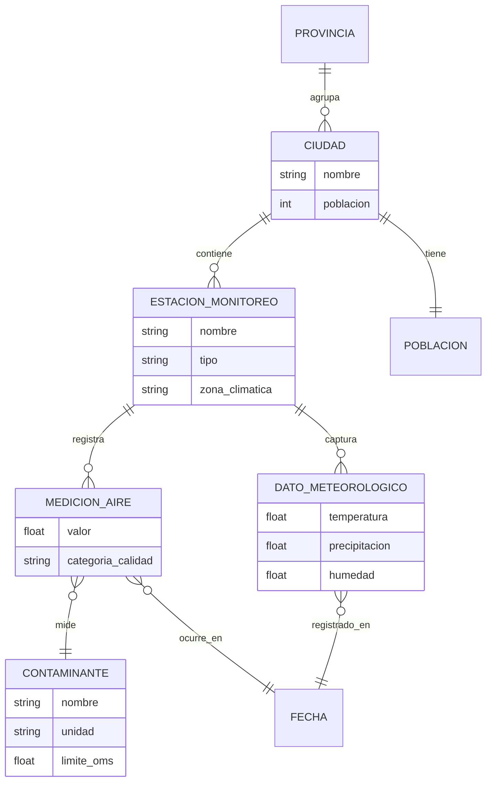
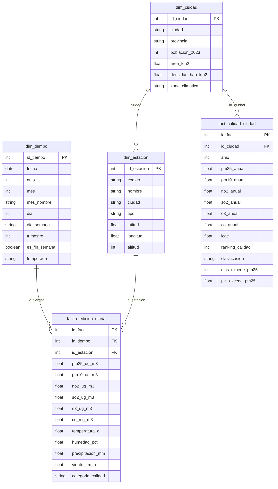
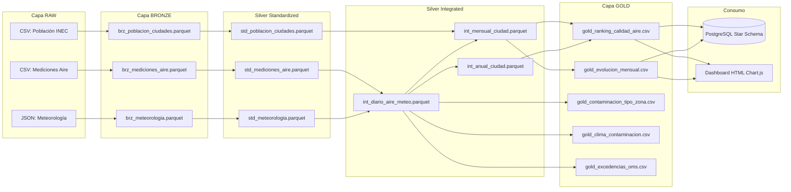
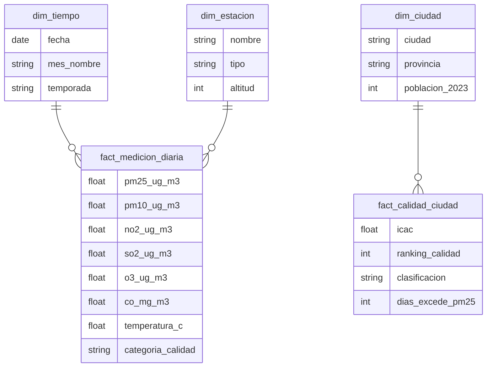

# Diagramas del Proyecto - Mermaid

## 1. Modelo Conceptual

Este diagrama representa las entidades principales del dominio y sus relaciones
a nivel de negocio, sin detalles técnicos de implementación.

## 2. Modelo Lógico

Este diagrama representa la estructura de datos con claves primarias,
claves foráneas, tipos de datos y relaciones con cardinalidad.

## 3. Arquitectura del Pipeline ETL

## 4. Star Schema HEFESTO

